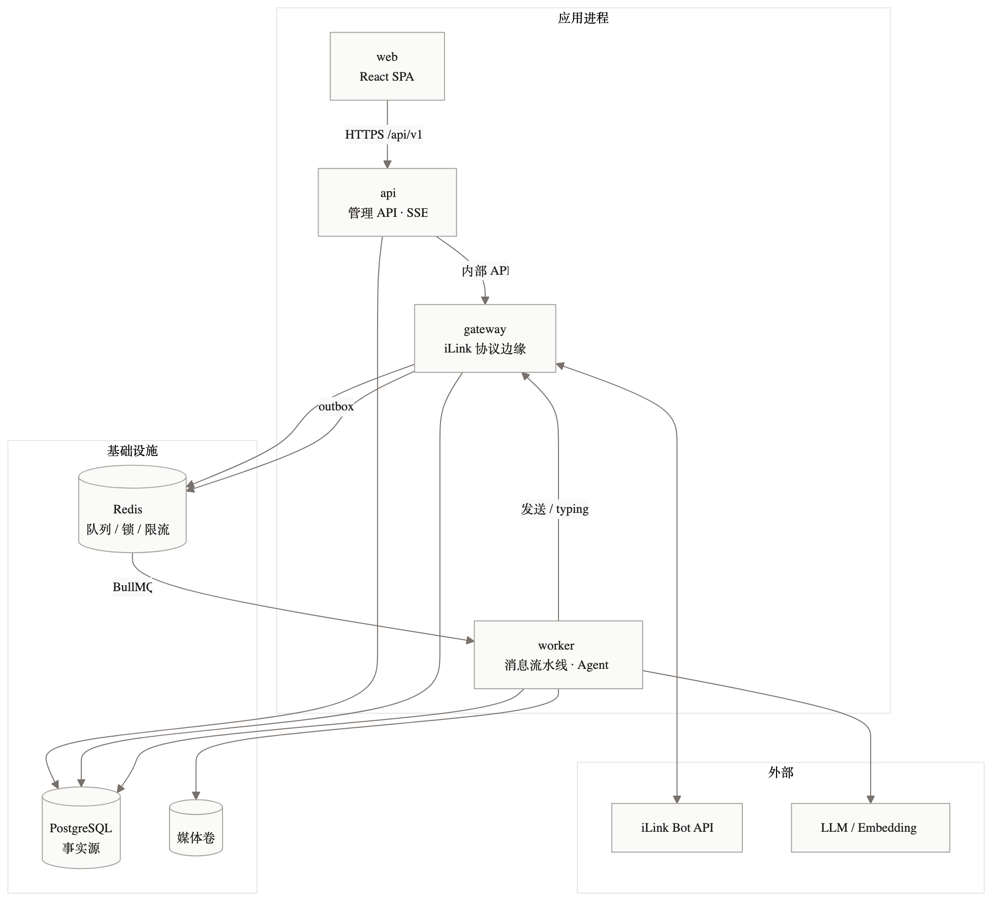
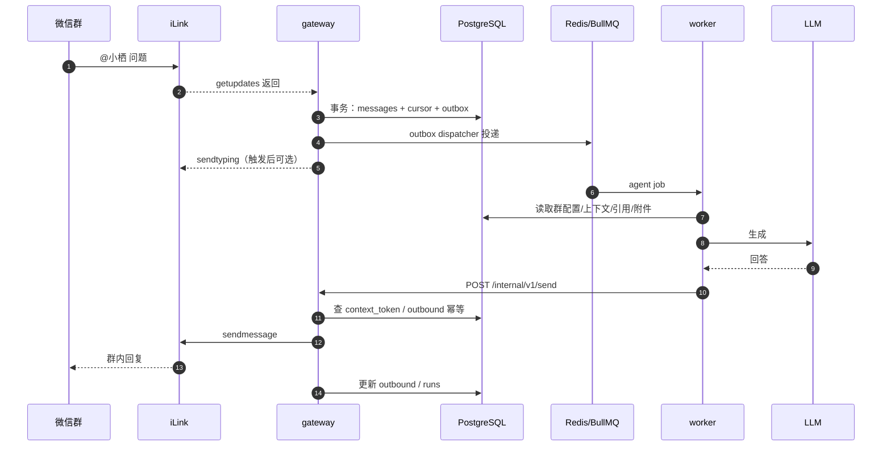
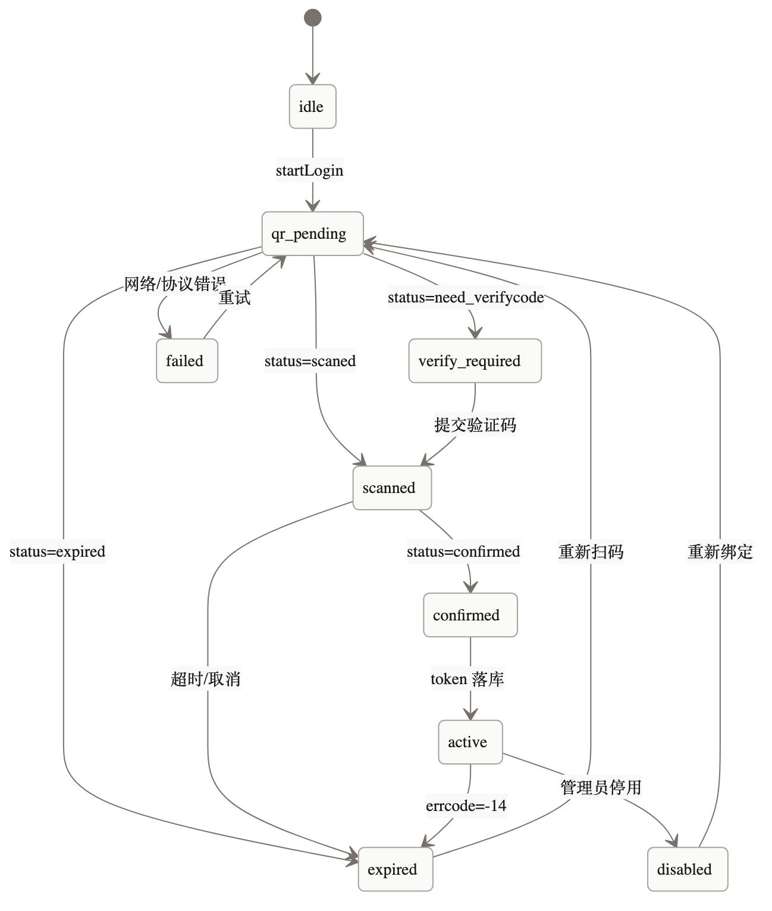

# 小栖 Xiaoqi · 详细设计 00 · 总览与运行时

> **归档提示（2026-11-06）**：Phase 0 群聊 No-Go；本文件为群版 future 参考。当前 v1 私聊设计见 [`../design-dm.md`](../design-dm.md)。


> 版本：v0.1  
> 日期：2026-11-06  
> 状态：设计评审稿  
> 前置阅读：[产品与架构设计](../design.md)、[品牌命名](../brand.md)  
> 说明：本系列文档锁定**实现级接口、数据、流程与测试**；产品取舍以 `docs/design.md` 为准。

---

## 1. 目标与假设

### 1.1 本系列要回答的问题

1. 每个进程具体做什么、边界在哪、怎么通信？
2. iLink 协议怎么封装，异常怎么映射，游标和 token 怎么存？
3. 一条群消息从进来到回复，经过哪些确定性步骤？
4. 上下文、摘要、RAG、工具的具体算法和预算是什么？
5. 数据库表、索引、Redis key、HTTP API 长什么样？
6. 怎么部署、怎么观测、怎么测试、怎么验收？

### 1.2 v1 假设

| 项 | 假设 |
|---|---|
| 账号 | 1 个 iLink bot 账号 |
| 群 | 2–5 个试点群，单群 ≤ 200 人 |
| 消息量 | 峰值 20 msg/min/群，日均 ≤ 2,000 条 |
| 部署 | 单机 2C4G，Docker Compose |
| 模型 | DeepSeek 默认，OpenAI-compatible |
| 数据库 | PostgreSQL 16 + pgvector |
| 队列 | Redis 7 + BullMQ |
| 前端 | React 19 + Vite，内部后台 |
| 租户 | 单运营方；代码预留 `account_id`/`group_id` 作用域 |

### 1.3 不在本系列范围

- 多租户计费、开放注册、SaaS 控制台
- 语音回复、图片/文件出站
- 微信群成员列表/群列表同步（协议不提供）
- 全量消息监听自动回复（默认关闭）

---

## 2. 运行时拓扑



### 2.1 进程

| 进程 | 端口 | 职责 | 扩缩容 |
|---|---|---|---|
| `web` | 由 Caddy 静态托管 | 管理后台 SPA | 无状态，可 CDN |
| `api` | 4100 | 管理 REST、SSE、静态资源、鉴权 | 无状态，可多副本 |
| `gateway` | 4101（仅内网） | iLink 登录、长轮询、发送、typing、限流、游标 | **每账号 1 个 leader** |
| `worker` | 4102（健康检查） | 消息流水线、Agent、RAG、摘要、提醒 | 可多副本，按群锁串行 |
| `postgres` | 5432 | 事实源 | 单机；后续主从 |
| `redis` | 6379 | BullMQ、锁、限流、短期缓存 | 单机；不做事实源 |
| `caddy` | 443/80 | TLS、反向代理、静态文件 | 单机 |

### 2.2 网络与信任边界

```text
Internet
  │ 443
Caddy ── /api/* ──> api:4100 ──内部 token──> gateway:4101
  └── /* ────────> web 静态文件

gateway:4101 ──出站 443──> ilinkai.weixin.qq.com
gateway:4101 ──出站 443──> novac2c.cdn.weixin.qq.com
worker ──出站 443──> LLM / Embedding provider
```

- `gateway` 和 `worker` **不暴露公网**；只监听 Docker 网络。
- 内部调用统一带 `x-xiaoqi-internal: <INTERNAL_TOKEN>`；token 只放 Docker secret。
- 管理后台可加 IP allowlist / VPN；默认公网仅开放 443。
- 管理 API 与 worker 不持有 iLink bot token；只有 gateway 能解密。

### 2.3 启动顺序

```text
postgres/redis healthy
  → gateway migrate? (no; api runs migrations)
  → api runs migrations → api ready
  → gateway starts pollers (leader lock)
  → worker starts queues
  → caddy starts
```

迁移由 `api` 单独执行（`pnpm db:migrate`），多副本时用 advisory lock 防并发。

---

## 3. 模块边界

### 3.1 代码结构

```text
xiaoqi/
├─ apps/
│  ├─ api/
│  │  ├─ src/auth/          # 登录、TOTP、session、CSRF
│  │  ├─ src/routes/        # REST 路由
│  │  ├─ src/sse/           # SSE hub
│  │  ├─ src/gateway-client/# 调 gateway 内部 API
│  │  └─ src/server.ts
│  ├─ gateway/
│  │  ├─ src/login/         # 二维码登录状态机
│  │  ├─ src/poller/        # 长轮询、游标、leader
│  │  ├─ src/sender/        # 发送、分段、typing、限流
│  │  ├─ src/inbound/       # 原始消息落库 + outbox
│  │  ├─ src/internal/      # 内部 HTTP API
│  │  └─ src/server.ts
│  ├─ worker/
│  │  ├─ src/pipeline/      # 归一化、触发、上下文、格式化
│  │  ├─ src/agent/         # 模型调用、工具循环
│  │  ├─ src/tools/         # 工具实现
│  │  ├─ src/rag/           # 入库、检索、rerank
│  │  ├─ src/jobs/          # BullMQ 消费者、定时任务
│  │  └─ src/main.ts
│  └─ web/
│     ├─ src/pages/
│     ├─ src/components/
│     └─ src/lib/
├─ packages/
│  ├─ ilink/                # 协议、媒体、加解密、错误映射
│  ├─ core/                 # DB schema、迁移、配置、日志、错误、领域类型
│  ├─ contracts/            # Zod DTO、内部 API、SSE 事件
│  └─ prompts/              # 系统提示词、摘要/工具提示词、评测样例
├─ docs/
├─ docker-compose.yml
└─ pnpm-workspace.yaml
```

### 3.2 依赖规则

| 包 | 可以依赖 | 禁止依赖 |
|---|---|---|
| `packages/ilink` | `core`（仅类型/错误） | `apps/*`、DB ORM、Fastify |
| `packages/core` | 无业务包 | `apps/*` |
| `packages/contracts` | `core` | `apps/*`、`ilink` |
| `packages/prompts` | 无 | `apps/*` |
| `apps/gateway` | `ilink`、`core`、`contracts` | `apps/worker`、`apps/api` |
| `apps/worker` | `core`、`contracts`、`prompts` | `ilink`（不直接收发） |
| `apps/api` | `core`、`contracts` | `ilink`（只调 gateway） |

强制用 ESLint `no-restricted-imports` + `dependency-cruiser` 检查。

### 3.3 领域类型

```ts
// packages/core/src/domain.ts
export type ConversationKind = "group" | "dm";

export interface ConversationKey {
  accountId: string;
  kind: ConversationKind;
  /** group: wx_group_id; dm: wx_user_id */
  externalId: string;
}

export type TriggerReason =
  | "mention"
  | "command"
  | "reply_to_bot"
  | "dm"
  | "all_messages"
  | "scheduled";

export interface NormalizedMessage {
  accountId: string;
  wxMessageId: string;
  seq: number;
  conversation: ConversationKey;
  senderId: string;
  senderDisplayName?: string;
  text: string;
  mentions: string[];
  quote?: {
    wxMessageId?: string;
    senderId?: string;
    text?: string;
    isBotMessage?: boolean;
  };
  media: MediaRef[];
  receivedAt: Date;
  raw: unknown;
}

export interface MediaRef {
  kind: "image" | "voice" | "file" | "video";
  mediaId: string;
  mime?: string;
  fileName?: string;
  sizeBytes?: number;
  transcript?: string;
}
```

---

## 4. 端到端流程

### 4.1 入站 → 回复



关键顺序：

1. **先落库再更新游标**（同一事务），失败则本轮不推进游标。
2. outbox 在事务提交后异步投递；worker 至少一次消费。
3. 发送统一走 gateway，worker 不直接调 iLink。
4. 发送前检查 `(run_id, chunk_index)` 幂等，重复请求返回已发送结果。

### 4.2 扫码登录



1. 管理员在后台点“绑定/重新登录”；首次先 `POST /api/v1/accounts` 创建待绑定账号（`ilink_bot_id=pending:<uuid>`）。
2. `api` 调 gateway `POST /internal/v1/accounts/:id/login/start`。
3. gateway 请求 `get_bot_qrcode`，写 `login_sessions`（状态 `qr_pending`，二维码 URL，过期时间）。
4. 前端 SSE 每 1s 读 `login_sessions`（或 API 轮询 DB），展示二维码和状态。
5. 手机扫码 → gateway 轮询 `get_qrcode_status` → 更新状态；需要验证码时，前端输入，API 调 gateway verify。
6. `confirmed` → 加密 `bot_token` 写 `accounts`，状态 `active`；写审计。
7. 轮询进程获取 leader 锁，开始 `getupdates`。

### 4.3 群聊总结

1. `/summary today` 触发（命令，不经过 LLM 意图）。
2. worker 读取时间范围内消息（上限 200 条 / 8k tokens）。
3. 调摘要模型，要求结构化 JSON（结论/待办/分歧/引用）。
4. 渲染为纯文本，分段发送。
5. 写 `runs`，更新 `conversation_state`（可选，仅当总结覆盖最近窗口）。

### 4.4 提醒

1. `/remind 周五18:00 发版检查` 解析时间、落 `reminders`。
2. 定时任务到期前 1 分钟取任务，检查群 `context_token` 新鲜度。
3. 新鲜 → 调 gateway 发送；不新鲜 → 标记 `failed` + 告警，不重试到天荒地老。
4. 成功后写 `sent_at`；失败记录错误码。

### 4.5 会话过期恢复

```text
poll 收到 errcode=-14
  → 停止该账号 poll loop
  → accounts.status = expired
  → 写 audit / alert
  → 后台横幅 + Webhook
  → 管理员扫码
  → 新 token 落库，启动 poller，从持久化游标继续
```

---

## 5. 内部 API 契约

所有内部接口：

- Base path：`/internal/v1`
- Header：`x-xiaoqi-internal: <token>`
- Content-Type：`application/json`
- 超时：调用方 10s；发送接口 30s
- 错误：`{ "error": { "code", "message", "retryable" } }`

### 5.1 发送消息

`POST /internal/v1/send`

```json
{
  "runId": "01JABCDEF...",
  "chunkIndex": 0,
  "accountId": "0b6f...",
  "conversation": { "kind": "group", "externalId": "123456@chatroom" },
  "replyToMessageId": 987654321,
  "text": "结论是 11 月 12 日灰度。",
  "contextToken": null
}
```

响应 200：

```json
{
  "ok": true,
  "wxMessageId": "1234567890123456789",
  "sentAt": "2026-11-06T03:12:45.123Z",
  "deduplicated": false
}
```

错误：

| code | HTTP | retryable | 含义 |
|---|---|---|---|
| `CONTEXT_TOKEN_MISSING` | 409 | false | 无可用 token，不能主动发 |
| `CONTEXT_TOKEN_EXPIRED` | 409 | false | token 过期/发送失败 |
| `SEND_RATE_LIMITED` | 429 | true | 本地/远端限流 |
| `ILINK_SEND_FAILED` | 502 | true | 网络/5xx |
| `ILINK_AUTH_EXPIRED` | 401 | false | 会话过期，需重登 |
| `OUTBOUND_DUPLICATE` | 200 | — | 已发送，返回原结果 |
| `CHUNK_INDEX_INVALID` | 400 | false | 分段索引非法 |

处理顺序：

1. 校验内部 token、参数。
2. `SELECT ... FROM outbound_messages WHERE run_id=? AND chunk_index=?`。
   - `sent` → 直接返回，`deduplicated=true`。
   - `sending` 且 `updated_at` < 2 分钟 → 视为卡住，允许重试；否则 409。
3. 解析 context token：
   - 请求显式提供 → 用；
   - 否则按 `replyToMessageId` 查 `context_tokens`（最近一次）；
   - 仍无 → `CONTEXT_TOKEN_MISSING`。
4. 生成 `client_id = "xiaoqi-" + runId + "-" + chunkIndex`（≤ 64 字符）。
5. 调 iLink `sendmessage`，2 次重试（网络/5xx）。
6. 事务更新 outbound + runs + usage。
7. 返回。

### 5.2 typing

`POST /internal/v1/typing`

```json
{
  "accountId": "0b6f...",
  "conversation": { "kind": "group", "externalId": "123@chatroom" },
  "userId": "o9cq...@im.wechat",
  "on": true
}
```

- gateway 缓存 `typing_ticket`（按 user），TTL 10 分钟；没有则调 `getconfig`。
- 失败不影响回答，只记日志。
- typing 每 25s 续一次，最多 90s；worker 负责续期，gateway 只执行单次。

### 5.3 登录

| 方法 | 路径 | 说明 |
|---|---|---|
| POST | `/internal/v1/accounts/:id/login/start` | 获取二维码，写 login_sessions |
| GET | `/internal/v1/accounts/:id/login/:loginId` | 查状态快照 |
| POST | `/internal/v1/accounts/:id/login/:loginId/verify` | 提交验证码 |
| POST | `/internal/v1/accounts/:id/logout` | 停止 poll、清 token、状态 disabled |

### 5.4 健康

`GET /internal/v1/health` → `{ ok, uptime, pollers: [...] }`；只给 API/worker 用。

---

## 6. 并发与锁

### 6.1 账号轮询 leader

- Key：`xiaoqi:lock:poll:{accountId}`
- 获取：`SET key instanceId NX PX 45000`
- 续期：每 15s `PEXPIRE`，仅当 value 匹配（Lua）。
- 失去锁：立即取消当前长轮询（AbortController），停止写游标。
- 同一账号只允许一个 gateway 实例轮询；多副本安全。

### 6.2 群串行

- Key：`xiaoqi:lock:group:{groupId}`
- TTL：120s；每 30s 续期；value = runId。
- 获取失败：BullMQ job 延迟 2s 重试，最多 30s；超时退回队列。
- 锁丢失：中止 LLM 请求，不再发送；run 标记 `failed`，错误 `GROUP_LOCK_LOST`。

### 6.3 合并窗口

- 同群同用户 800ms 内多条文本 → 合并。
- 实现：worker 收到 job 后，`SET xiaoqi:merge:{groupId}:{userId} NX PX 800`；若失败，把消息追加到 Redis list，首个 job 延迟 800ms 后读取并合并。
- 合并只针对文本；图片/文件各自保留。

### 6.4 速率限制

| 维度 | 默认 | 实现 |
|---|---|---|
| 入站处理 | 每群 1 并发 | 群锁 |
| 出站 | 每账号 20 条/分钟，每群 10 条/分钟 | Redis 令牌桶 |
| 用户冷却 | 3s | `SET NX EX 3` |
| 每群回复 | 30 条/小时 | 滑动窗口计数 |
| typing | 每群 1 次/25s | 本地 + Redis |

超过限制：不回复或延迟回复；交互优先于定时任务。

---

## 7. 事务与幂等

### 7.1 入站事务

```ts
await db.transaction(async (tx) => {
  const inserted = await tx.insert(messages).values(...).onConflictDoNothing();
  if (!inserted) return; // 重复消息
  await tx.update(accountCursors).set({ buf: newBuf, updatedAt: now });
  await tx.insert(outbox).values({ topic: "inbound", payload: { messageId } });
});
```

失败：事务回滚，游标不变，下一轮重新拉取；重复由唯一约束消化。

### 7.2 发送幂等

```text
outbound_messages(run_id, chunk_index) UNIQUE
状态：pending → sending → sent | failed
```

- 发送前插入 `pending`；如果冲突，读现有状态。
- 发送成功后更新 `sent` + `wx_message_id`。
- 重试时 `sending` 超过 2 分钟视为可重试。
- 部分成功：已 `sent` 的 chunk 不重发。

### 7.3 定时任务幂等

`reminders` 状态机：`scheduled → sending → sent | failed | cancelled`；用 `SELECT ... FOR UPDATE SKIP LOCKED` + 状态迁移保证一次，发送以 reminder id 为幂等键。

---

## 8. 横切约定

### 8.1 ID

| 实体 | 类型 | 生成 |
|---|---|---|
| 账号/群/成员/文档 | uuid | `crypto.randomUUID()` |
| 消息 | bigserial | DB |
| run / outbound / login | uuid | `crypto.randomUUID()` |
| trace | W3C trace-id | OpenTelemetry |
| Redis key 片段 | 外部 ID | 原样（群 ID 含 `@`） |

### 8.2 时间

- DB 全部 `timestamptz`，存 UTC。
- 业务展示 `Asia/Shanghai`。
- 提醒时间存 UTC + 原始时区。
- 所有 API 返回 ISO 8601。

### 8.3 金额

- 内部 `cost_usd numeric(12,6)`。
- 展示按配置汇率换算 CNY；汇率写在 `settings`，不硬编码。
- 预算按 CNY 配置，网关/worker 换算成 USD 比较。

### 8.4 错误

```ts
class AppError extends Error {
  constructor(
    readonly code: string,
    message: string,
    readonly httpStatus = 500,
    readonly retryable = false,
    readonly meta?: Record<string, unknown>,
  ) { super(message); }
}
```

- 用户可见错误只用固定文案 + trace id。
- 日志记录 code、stack、context；不记录 token/正文。
- `retryable` 决定 BullMQ 重试。

### 8.5 日志

- pino JSON；字段：`level, time, service, traceId, accountId, groupId, runId, event, durationMs, errorCode`。
- 默认不记录消息正文；`LOG_MESSAGE_CONTENT=true` 仅本地调试，启动时告警。
- 脱敏：`authorization`, `x-xiaoqi-internal`, `token`, `aeskey`, `phone`, `email`。

### 8.6 配置

- 环境变量用 Zod 校验，启动失败即退出。
- 群级配置存 `groups.settings`，PATCH 时全量校验（JSON Schema）。
- 功能开关：`features.webSearch`, `features.reminders`, `features.proactiveDigest`。

### 8.7 文件与媒体

- 媒体存 `MEDIA_DIR/{accountId}/{yyyy}/{mm}/{sha256}.{ext}`。
- 只存解密后的内容；AES key 加密存 `media_assets.aes_key_enc`，仅用于重传/审计，v1 可空。
- 文件权限 0600，目录 0700；不通过静态服务器暴露。

---

## 9. 失败域

| 故障 | 影响 | 行为 |
|---|---|---|
| iLink 5xx/网络 | 收/发失败 | 指数退避；发送进重试；不推进游标 |
| iLink `-14` | 账号掉线 | 停 poll、状态 expired、告警、等扫码 |
| PostgreSQL 不可用 | 无法落库 | **停止 poll**（不能推进游标）；发送失败重试；告警 |
| Redis 不可用 | 队列/锁不可用 | 入站仍落库 + outbox；worker 停；恢复后重放 |
| gateway 不可用 | 无法发送 | worker 发送失败 → 重试/死信；告警 |
| worker 不可用 | 队列积压 | 告警；恢复后消费；交互消息优先 |
| LLM 超时/5xx | 回答失败 | 1 次重试 + 备用模型；仍失败给兜底 |
| 磁盘满 | 媒体写入失败 | 停止媒体处理；告警；文本问答继续 |
| 群锁丢失 | 并发风险 | 中止 run，不发送；下一条重新排队 |

---

## 10. 文档索引

| 文档 | 内容 |
|---|---|
| [00 总览与运行时](./00-overview.md) | 进程、模块、内部 API、并发、失败域 |
| [01 iLink 协议适配](./01-ilink-adapter.md) | 登录、轮询、发送、媒体、错误映射 |
| [02 消息流水线](./02-pipeline.md) | 归一化、触发、上下文、分段、重试 |
| [03 Agent 与 RAG](./03-agent.md) | 模型、提示词、工具、检索、安全、评测 |
| [04 数据与 API](./04-data-api.md) | DDL、Redis、REST、SSE、权限 |
| [05 运维与测试](./05-ops-test.md) | 部署、观测、测试矩阵、验收、里程碑 |

---

## 11. Phase 0 对详细设计的约束

以下行为在 Phase 0 前按“可替换”设计，不写死：

| 未确认项 | 设计中的抽象 | 确认后动作 |
|---|---|---|
| 群回复用 `group_id` 还是 sender | `ReplyTargetResolver` | 只改 resolver + fixture |
| @ 是纯文本还是结构化 | `MentionParser` | 增加结构化分支 |
| `context_token` 群级/用户级 | `ContextTokenStore` key 策略 | 改 key 组合 |
| 是否推送非 @ 消息 | `SummarySource` | 关闭/降级摘要 |
| 主动消息是否可用 | `ProactiveSender` | 关闭提醒/日报 |
| 媒体字段差异 | `MediaAdapter` | 改解密/下载实现 |

> 详细设计里所有“群回复字段”“@ 识别”都通过接口隔离；Phase 0 只改适配层，不重写业务。
