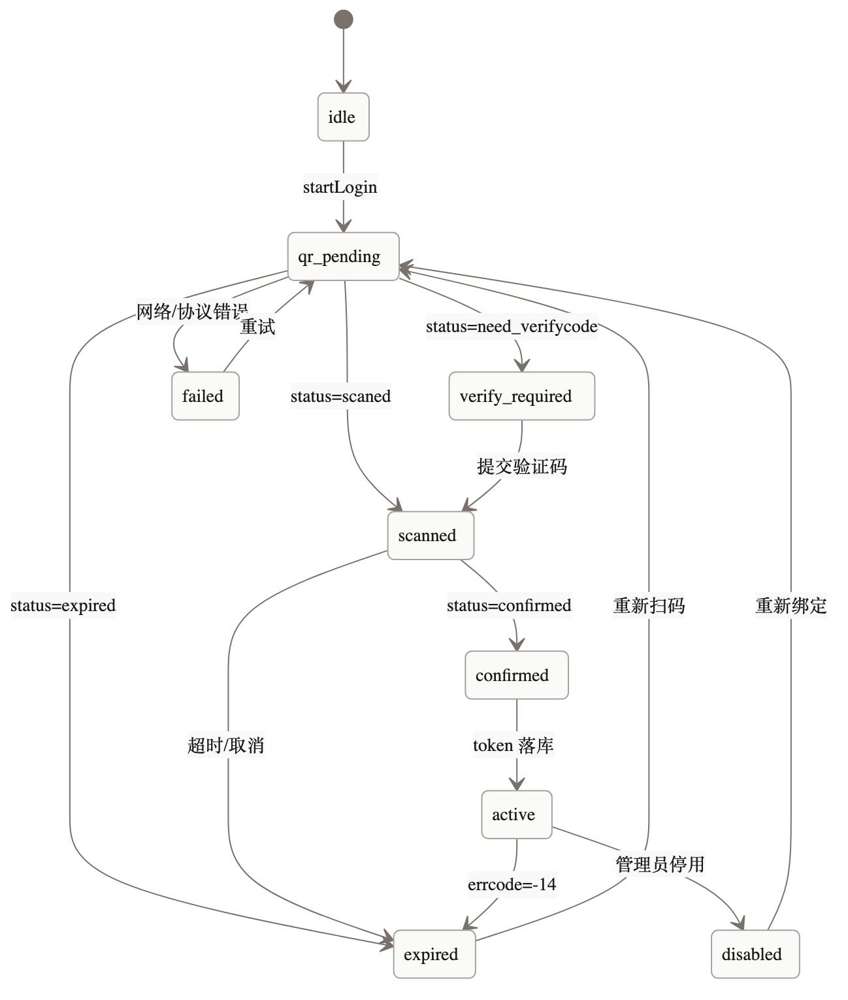

# 小栖 Xiaoqi · 详细设计 01 · iLink 协议适配

> **归档提示（2026-11-06）**：Phase 0 群聊 No-Go；本文件为群版 future 参考。当前 v1 私聊设计见 [`../design-dm.md`](../design-dm.md)。


> 对应代码：`packages/ilink`、`apps/gateway`  
> 目标：把 iLink 的 HTTP/长轮询/媒体细节封在一个可替换的适配层里，业务层只看到领域消息。  
> 前置：[00 总览](./00-overview.md)、[Phase 0 探针](../protocol-probe.md)

---

## 1. 边界

### 1.1 做什么

- 扫码登录、token 加密持久化
- `getupdates` 长轮询、游标、去重前置
- `sendmessage` 文本发送、typing、停止/启动通知
- 图片/文件/语音/视频的 CDN 下载与 AES-128-ECB 解密
- 错误码到领域错误的映射
- 每账号 leader 锁、发送限流
- 录制/回放协议 fixture

### 1.2 不做什么

- 不判断“要不要回复”（触发策略在 worker）
- 不构建上下文、不调 LLM
- 不决定分段（worker 决定，gateway 按段发送）
- 不直接写 `runs`（只更新发送结果）

### 1.3 目录

```text
packages/ilink/
├─ src/
│  ├─ client.ts          # 低层 HTTP 客户端
│  ├─ auth.ts            # 登录状态机
│  ├─ poll.ts            # 长轮询循环（可被 gateway 复用）
│  ├─ send.ts            # 发送/typing
│  ├─ media.ts           # 下载/解密/上传
│  ├─ crypto.ts          # AES-GCM token、AES-ECB 媒体
│  ├─ errors.ts          # 错误映射
│  ├─ types.ts           # wire/domain 类型
│  └─ fixtures/          # 脱敏后的请求/响应
└─ test/
   ├─ fake-ilink/        # 本地假服务器
   └─ contract.test.ts
```

---

## 2. Wire 类型

以官方包 `@tencent-weixin/openclaw-weixin` 2.4.10 的类型为参考，自建客户端只保留需要的字段。

```ts
// packages/ilink/src/types.ts
export interface BaseInfo {
  channel_version?: string;
  bot_agent?: string;
}

export const MessageType = { USER: 1, BOT: 2 } as const;
export const MessageState = { NEW: 0, GENERATING: 1, FINISH: 2 } as const;
export const ItemType = {
  TEXT: 1,
  IMAGE: 2,
  VOICE: 3,
  FILE: 4,
  VIDEO: 5,
  TOOL_CALL_START: 11,
  TOOL_CALL_RESULT: 12,
} as const;

export interface CDNMedia {
  encrypt_query_param?: string;
  aes_key?: string;        // base64
  encrypt_type?: number;
  full_url?: string;
}

export interface TextItem { text?: string }
export interface ImageItem {
  media?: CDNMedia;
  thumb_media?: CDNMedia;
  aeskey?: string;         // hex, inbound preferred
  url?: string;
  thumb_size?: number;
  thumb_width?: number;
  thumb_height?: number;
  hd_size?: number;
}
export interface VoiceItem {
  media?: CDNMedia;
  encode_type?: number;
  sample_rate?: number;
  playtime?: number;
  text?: string;           // ASR transcript
}
export interface FileItem {
  media?: CDNMedia;
  file_name?: string;
  md5?: string;
  len?: string;
}
export interface VideoItem {
  media?: CDNMedia;
  video_size?: number;
  play_length?: number;
  video_md5?: string;
  thumb_media?: CDNMedia;
}

export interface RefMessage {
  message_item?: MessageItem;
  title?: string;
  svr_id?: string;
}

export interface MessageItem {
  type?: number;
  create_time_ms?: number;
  update_time_ms?: number;
  is_completed?: boolean;
  msg_id?: string;
  ref_msg?: RefMessage;
  text_item?: TextItem;
  image_item?: ImageItem;
  voice_item?: VoiceItem;
  file_item?: FileItem;
  video_item?: VideoItem;
}

export interface WeixinMessage {
  seq?: number;
  message_id?: string;
  from_user_id?: string;
  to_user_id?: string;
  client_id?: string;
  create_time_ms?: number;
  update_time_ms?: number;
  session_id?: string;
  group_id?: string;
  message_type?: number;
  message_state?: number;
  item_list?: MessageItem[];
  context_token?: string;
  run_id?: string;
}

export interface GetUpdatesResp {
  ret?: number;
  errcode?: number;
  errmsg?: string;
  msgs?: WeixinMessage[];
  get_updates_buf?: string;
  longpolling_timeout_ms?: number;
}
```

> 所有 `uint64`（`message_id`、`svr_id`）按**字符串**处理，禁止 `Number()`，避免 JS 精度丢失。

---

## 3. HTTP 客户端

### 3.1 基础配置

```ts
export interface ILinkConfig {
  baseUrl: string;             // login 返回的 baseurl 或默认
  token: string;               // bot_token
  appId?: string;              // 默认 "bot"
  clientVersion: number;       // 0x00MMNNPP
  routeTag?: string;           // 可选 SKRouteTag
  timeoutMs: number;           // 默认 15_000
  longPollTimeoutMs: number;   // 默认 35_000
  userAgent: string;           // "Xiaoqi/0.1"
}
```

### 3.2 请求头

```http
Content-Type: application/json
AuthorizationType: ilink_bot_token
Authorization: Bearer <bot_token>
X-WECHAT-UIN: <base64(random uint32)>
iLink-App-Id: bot
iLink-App-ClientVersion: 132106
SKRouteTag: <optional>
```

- `X-WECHAT-UIN` **每个请求重新生成**：`crypto.randomBytes(4).readUInt32LE()` → 十进制字符串 → base64。
- `baseUrl` 以登录返回的 `baseurl` 为准；为空时用 `https://ilinkai.weixin.qq.com`。
- 不在 URL/日志里拼接 token。

### 3.3 超时与重试

| 请求 | 超时 | 重试 | 说明 |
|---|---|---|---|
| `get_bot_qrcode` | 10s | 2 | 幂等 |
| `get_qrcode_status` | 40s | 0（外层循环） | 长轮询挂起 |
| `getupdates` | 40s | 0（外层循环） | 长轮询；不要叠加大量并发 |
| `sendmessage` | 20s | 2 | 仅网络/5xx/429；同 `client_id` |
| `getuploadurl` | 10s | 2 | 幂等 |
| CDN PUT | 60s | 2 | 幂等（同 URL） |
| `getconfig` | 10s | 2 | 缓存 ticket |
| `sendtyping` | 5s | 0 | 失败不影响主流程 |
| `notifystart/stop` | 5s | 1 | 优雅上下线 |

退避：`500ms, 1.5s, 4s` + ±20% jitter。`429` 优先读 `Retry-After`。

### 3.4 响应解析

- 先看 HTTP status；非 2xx 映射 `HTTP_<status>`。
- JSON 解析失败 → `ILINK_BAD_RESPONSE`（不可重试，记录前 500 字符脱敏响应）。
- `ret != 0` 或 `errcode != 0` → `ILinkAPIError`，保留 `op/ret/errcode/errmsg`。

```ts
export class ILinkAPIError extends AppError {
  constructor(
    readonly op: string,
    readonly ret: number,
    readonly errcode: number,
    readonly errmsg: string,
    readonly httpStatus: number,
  ) {
    super("ILINK_API_ERROR", `iLink ${op} ret=${ret} errcode=${errcode}`, 502,
      isRetryable(ret, errcode, httpStatus),
      { op, ret, errcode, errmsg });
  }
}
```

---

## 4. 登录

### 4.1 状态机



状态存 `login_sessions`（见 04）：

```ts
type LoginStatus =
  | "qr_pending"
  | "scanned"
  | "verify_required"
  | "confirmed"
  | "expired"
  | "failed"
  | "disabled";
```

### 4.2 开始登录

`POST /ilink/bot/get_bot_qrcode?bot_type=3`

```json
{ "local_token_list": ["<existing bot token>"] }
```

响应：

```json
{
  "qrcode": "....",
  "qrcode_img_content": "https://...."
}
```

- `bot_type=3` 与官方实现一致；若 Phase 0 发现不同，只改常量。
- 返回的二维码内容可能是 URL，也可能是可渲染字符串；前端用二维码库渲染。
- 写 `login_sessions`：`id, account_id, status=qr_pending, qr_url, qr_content_enc, expires_at`。
- 二维码 TTL 默认 5 分钟；过期后前端提示重新获取。

### 4.3 轮询状态

`GET /ilink/bot/get_qrcode_status?qrcode=<qrcode>`；需要验证码时追加 `&verify_code=...`。

| status | 处理 |
|---|---|
| `wait` | 继续轮询，间隔 1s |
| `scaned` | 更新 `scanned`；继续 |
| `confirmed` | 保存 `bot_token`、`baseurl`、`ilink_bot_id`；状态 `confirmed` |
| `expired` | 状态 `expired`；停止轮询 |
| `scaned_but_redirect` | 用 `redirect_host` 更新 base URL，继续轮询 |
| `need_verifycode` | 状态 `verify_required`；等待用户输入 |
| `verify_code_blocked` | 状态 `failed`，提示稍后再试 |
| `binded_redirect` | 已有绑定；走已有 token 恢复 |

- 轮询循环在 gateway 内，每个 login session 一个 AbortController。
- 客户端超时（40s）视为 `wait`，继续；网络错误也继续，最多 5 分钟。
- 用户取消/关闭页面：调用 `POST /internal/v1/accounts/:id/login/:loginId/cancel`（可选），或等待 TTL。

### 4.4 保存 token

```ts
interface StoredToken {
  botToken: string;
  baseUrl: string;
  ilinkBotId: string;
  savedAt: string;
}
```

加密：

```text
alg = AES-256-GCM
key = MASTER_KEY (32 bytes, base64 env)
iv  = 12 random bytes
aad = "xiaoqi:account-token:v1"
ciphertext = AES-GCM(key, iv, plaintext, aad)
stored = "v1:" + kid + ":" + b64(iv) + ":" + b64(tag) + ":" + b64(ciphertext)
```

- `accounts.token_enc` 存 `stored`；`token_kid` 存 key 版本。
- 解密只在 gateway 启动/发送时发生，结果放内存，不落日志。
- 轮换：新 key 写 `MASTER_KEY_NEXT`；后台任务重加密；旧 key 保留 30 天。

### 4.5 登录后启动

- 账号状态 `active`，`last_poll_at=now`。
- gateway 尝试获取 `xiaoqi:lock:poll:{accountId}`；拿到后启动 poller。
- 若已有 leader，本实例保持 standby，定期检查锁。
- 调用 `notifystart`（失败不阻塞）。

---

## 5. 长轮询

### 5.1 循环

```ts
async function pollLoop(ctx: PollContext) {
  let backoff = 500;
  while (!ctx.signal.aborted) {
    try {
      const resp = await client.getUpdates({
        getUpdatesBuf: ctx.cursor.buf,
        timeoutMs: ctx.longPollTimeoutMs,
      });
      if (resp.errcode === -14) throw new SessionExpiredError();
      if (resp.ret && resp.ret !== 0) throw mapApiError("getupdates", resp);

      if (resp.msgs?.length) {
        await persistBatch(ctx, resp.msgs, resp.get_updates_buf ?? ctx.cursor.buf);
      } else if (resp.get_updates_buf && resp.get_updates_buf !== ctx.cursor.buf) {
        await updateCursor(ctx, resp.get_updates_buf);
      }

      backoff = 500;
    } catch (err) {
      if (err instanceof SessionExpiredError) {
        await onSessionExpired(ctx);
        return;
      }
      logger.warn({ err, accountId: ctx.accountId }, "poll failed");
      await sleep(backoff + jitter());
      backoff = Math.min(backoff * 2, 30_000);
    }
  }
}
```

### 5.2 游标

- `account_cursors.buf` 存最近一次成功处理的 `get_updates_buf`。
- **只有消息落库事务提交后**才更新游标。
- 无消息但服务端返回新 buf：也更新（减少重复窗口）。
- 服务端返回空 buf 或 buf 回退：记录警告，不主动清空；若连续 3 次，重建游标（从空开始）并告警。
- 重启后从 DB 读 buf；若为空，从 `""` 开始。

### 5.3 批量持久化

```ts
async function persistBatch(ctx, msgs, nextBuf) {
  const normalized = msgs
    .filter(m => m.message_type === 1)
    .map(m => normalizeInbound(m));

  await db.transaction(async (tx) => {
    for (const m of normalized) {
      const inserted = await tx.insert(messages).values(m).onConflictDoNothing();
      if (inserted) {
        await tx.insert(outbox).values({
          topic: "inbound",
          payload: { accountId: m.accountId, wxMessageId: m.wxMessageId },
        });
      }
    }
    await tx.update(accountCursors)
      .set({ buf: nextBuf, updatedAt: new Date() })
      .where(eq(accountCursors.accountId, ctx.accountId));
  });
}
```

- 单条消息解析失败：记录 `inbound_errors`（或日志 + 死信），**不阻塞整批**。
- 事务失败：整批回滚，游标不推进；下一轮重试。
- 去重：`(account_id, wx_message_id)` 唯一。

群/成员发现（同一事务）：

```sql
insert into groups (account_id, wx_group_id, name, status, last_message_at)
values ($1, $2, '', 'active', now())
on conflict (account_id, wx_group_id) do update
  set last_message_at = excluded.last_message_at;

insert into members (group_id, wx_user_id, last_seen_at, message_count)
values ($1, $2, now(), 1)
on conflict (group_id, wx_user_id) do update
  set last_seen_at = now(), message_count = members.message_count + 1;
```

- 仅 `group_id` 存在时执行；私聊不创建群。
- iLink 没有群列表/成员列表 API，只能靠消息惰性发现。
- 群名初始为空，管理员在后台命名；显示名同理。

### 5.4 自循环防护

- `message_type === 2`（bot）直接丢弃。
- `from_user_id === account.ilink_bot_id` 丢弃。
- 同一群 5 分钟内 3 次相同文本：暂停该群 10 分钟并告警（在 worker 触发层做）。

### 5.5 优雅停止

```text
SIGTERM
  → 停止接受新 job（worker）
  → gateway abort 长轮询
  → 调 notifystop（5s 超时）
  → 释放 leader 锁
  → 关闭 HTTP
```

---

## 6. 发送

### 6.1 请求构造

```ts
interface SendTextInput {
  toUserId: string;           // group_id 或 sender
  contextToken: string;
  text: string;
  clientId: string;           // 幂等键
  runId?: string;
}

function buildSendMessage(input: SendTextInput): SendMessageReq {
  return {
    msg: {
      from_user_id: "",
      to_user_id: input.toUserId,
      client_id: input.clientId,
      message_type: MessageType.BOT,
      message_state: MessageState.FINISH,
      context_token: input.contextToken,
      run_id: input.runId,
      item_list: [{ type: ItemType.TEXT, text_item: { text: input.text } }],
    },
  };
}
```

- `client_id` 必须稳定：`xiaoqi-{runId}-{chunkIndex}`，长度 ≤ 64。
- 文本为空不发送。
- 不在文本里附加追踪 ID（用户不可见）；追踪在 `runs`。

### 6.2 ReplyTargetResolver

Phase 0 未确认群回复字段，因此抽象：

```ts
interface InboundRef {
  senderId: string;
  wxMessageId: string;
}

interface ReplyTarget {
  toUserId: string;
  contextToken: string;
}

interface ReplyTargetResolver {
  resolve(conversation: ConversationKey, trigger: InboundRef): Promise<ReplyTarget>;
}
```

实现：

```ts
class GroupReplyResolver implements ReplyTargetResolver {
  async resolve(conv, trigger) {
    const token = await contextTokenStore.get(conv, trigger);
    if (!token) throw new AppError("CONTEXT_TOKEN_MISSING", ..., 409, false);

    switch (config.groupReplyTarget) {
      case "group":   return { toUserId: conv.externalId, contextToken: token };
      case "sender":  return { toUserId: trigger.senderId, contextToken: token };
      case "auto":    return { toUserId: this.autoTarget(conv, trigger), contextToken: token };
    }
  }

  private autoTarget(conv: ConversationKey, trigger: InboundRef): string {
    const mode = process.env.ILINK_GROUP_REPLY_TARGET ?? "group";
    return mode === "sender" ? trigger.senderId : conv.externalId;
  }
}
```

- `config.groupReplyTarget` 来自 Phase 0 结论，默认 `auto`：按环境变量 `ILINK_GROUP_REPLY_TARGET`（`group`/`sender`）选择，**不做运行时双发探测**。
- Phase 0 确认后把 `ILINK_GROUP_REPLY_TARGET` 固定为实际值，避免每次发送多一次失败尝试。
- 私聊固定 `sender`。
- 失败不静默重试两种目标，避免重复消息；用幂等键 + 一次探测。

### 6.3 Context token 存储

```ts
interface ContextTokenStore {
  put(conv: ConversationKey, token: string, wxMessageId: string): Promise<void>;
  get(conv: ConversationKey, trigger?: InboundRef): Promise<string | null>;
  touch(conv: ConversationKey): Promise<void>;
}
```

- Key：`accountId + ":" + conversationKey`；`conversationKey = "group:" + externalId` 或 `"dm:" + externalId`。
- 同时写内存 LRU（1000 条）+ DB `context_tokens`（加密）。
- Phase 0 若确认 token 是用户级，则 key 改为 `accountId + ":" + conversationKey + ":" + senderId`；只改 store 实现。
- 发送前 `get`：优先触发消息的 token；否则最近一次。
- 主动消息：只能使用最近一次 token，且检查 `updated_at` 新鲜度（默认 30 分钟，可配）；过期直接失败，不重试。

### 6.4 速率限制

```ts
// 令牌桶，Redis Lua 原子
const limits = {
  accountPerMinute: 20,
  groupPerMinute: 10,
  groupPerHour: 30,
};
```

- 发送前 `acquire`；拿不到 → `SEND_RATE_LIMITED`（retryable）。
- BullMQ 发送 job 延迟重试，最多 3 次；仍失败进死信 + 告警。
- 429：读 `Retry-After`，至少等 5s；不要立即重试。
- 同一群多段之间 sleep 400–800ms（worker 控制）。

### 6.5 typing

```ts
async function setTyping(accountId, userId, on: boolean) {
  const ticket = await getTypingTicket(accountId, userId);
  await client.sendTyping({
    ilink_user_id: userId,
    typing_ticket: ticket,
    status: on ? 1 : 2,
  });
}
```

- `getconfig` 需要 `ilink_user_id` + `context_token`；缓存 ticket 10 分钟。
- 失败只记 debug，不影响回答。
- worker 每 25s 续一次，最多 90s；发送完成后 `status=2`。

### 6.6 notifystart / notifystop

- 启动时调用一次；失败记录日志。
- 退出时调用，5s 超时；不阻塞退出超过 5s。
- 用途：让服务端知道客户端上下线；不是必须，但不能省掉优雅关闭。

---

## 7. 媒体

### 7.1 入站下载

```ts
function resolveCdnUrl(item: CDNMedia): string {
  if (item.full_url) return item.full_url;
  if (!item.encrypt_query_param) throw new AppError("MEDIA_URL_MISSING", ...);
  return `https://novac2c.cdn.weixin.qq.com/c2c?${item.encrypt_query_param}`;
}
```

- 下载前 HEAD/限制：最大 20MB；Content-Length 超限直接拒绝。
- 下载超时 30s；最多 2 次重试。
- 解密：
  - key：`image_item.aeskey`（hex，优先）或 `media.aes_key`（base64）。
  - 算法：AES-128-ECB + PKCS#7。
  - 解密后校验 magic：JPEG/PNG/WebP/PDF/ZIP/OLE；不匹配则标记 `failed`，不交给 LLM。
- 存储：解密后写 `MEDIA_DIR`；`media_assets` 记录 sha256、mime、size、storage_key。
- 恶意文件：v1 只做大小/MIME/魔数校验；ClamAV 作为 P2。

### 7.2 语音

- 优先 `voice_item.text`（微信转写）；有文本就不下载音频。
- 无转写：
  - v1 记录 `transcript_missing`，回复“这条语音我听不清，方便发文字吗？”
  - P1 接 ffmpeg + STT（SILK 解码）。
- 不把原始 SILK 直接给 LLM。

### 7.3 文件/图片理解

- 图片：下载 → 存 → 视觉模型生成描述（或直接多模态）；描述存 `media_assets.description`，上下文用描述 + 原图引用。
- 文件：PDF/DOCX/TXT 抽取文本；超过 200 页/20MB 拒绝；抽取失败告知用户。
- 视频：v1 只存封面/时长，不做理解。

### 7.4 出站（v1 不做）

保留接口：

```ts
interface MediaSender {
  sendImage(conv, data, opts): Promise<void>;
  sendFile(conv, data, opts): Promise<void>;
}
```

v1 不实现，避免上传/缩略图/CDN 的边界拖慢主线。

---

## 8. 错误映射

### 8.1 iLink 错误

| 来源 | 条件 | 领域错误 | 处理 |
|---|---|---|---|
| HTTP 401/403 | token 无效 | `ILINK_AUTH_EXPIRED` | 停止 poll，状态 expired |
| HTTP 429 | 限流 | `ILINK_RATE_LIMITED` | 退避，读 Retry-After |
| HTTP 5xx | 服务端 | `ILINK_UPSTREAM` | 重试 2 次 |
| `errcode=-14` | 会话过期 | `SESSION_EXPIRED` | 停止 poll，告警 |
| `ret=-1` | 通用失败 | `ILINK_API_ERROR` | 视 `retryable` |
| 网络超时 | — | `ILINK_TIMEOUT` | 重试 |
| JSON 解析失败 | — | `ILINK_BAD_RESPONSE` | 不重试，告警 |

### 8.2 媒体错误

| 条件 | 错误 | 用户提示 |
|---|---|---|
| 无 URL/key | `MEDIA_INVALID` | 这张图我读不了 |
| 解密失败 | `MEDIA_DECRYPT_FAILED` | 文件解析失败 |
| 超大小/页数 | `MEDIA_TOO_LARGE` | 文件太大，换个小一点的 |
| 不支持的 MIME | `MEDIA_UNSUPPORTED` | 暂不支持这种格式 |
| 下载超时 | `MEDIA_TIMEOUT` | 文件下载超时，稍后再试 |

### 8.3 发送错误

| 条件 | 错误 | 重试 |
|---|---|---|
| 无 context token | `CONTEXT_TOKEN_MISSING` | 否 |
| token 过期 | `CONTEXT_TOKEN_EXPIRED` | 否（等新消息） |
| 本地限流 | `SEND_RATE_LIMITED` | 是 |
| 群不存在/被移除 | `GROUP_UNAVAILABLE` | 否，标记群 inactive |
| 重复 chunk | `OUTBOUND_DUPLICATE` | 否，返回已发送 |

---

## 9. 测试

### 9.1 Fake iLink

`test/fake-ilink` 提供：

```text
POST /ilink/bot/get_bot_qrcode
GET  /ilink/bot/get_qrcode_status
POST /ilink/bot/getupdates
POST /ilink/bot/sendmessage
POST /ilink/bot/getconfig
POST /ilink/bot/sendtyping
POST /ilink/bot/getuploadurl
PUT  /cdn/:key
GET  /cdn/:key
```

能力：

- 脚本化返回：空消息、群消息、@ 消息、引用、重复 `message_id`、`errcode=-14`、429、500。
- 长轮询：hold 100ms（测试用），可配置返回。
- 媒体：返回 AES-ECB 加密的固定图片/PDF。
- 记录请求：断言 header、body、client_id、context_token。

### 9.2 契约用例

| 用例 | 断言 |
|---|---|
| 登录确认 | token 加密落库，baseurl 保存 |
| 重复消息 | 只入队一次，游标只前进一次 |
| 事务失败 | 游标不前进，下轮重试 |
| `-14` | 停止 poll、状态 expired、告警调用一次 |
| 发送重复 | 第二个请求返回 `deduplicated=true`，不重复调 iLink |
| 发送 429 | 退避重试，最终成功 |
| 媒体解密 | 图片/PDF 解密成功，sha256 一致 |
| 媒体炸弹 | 超 20MB 拒绝，不写盘 |
| 主动消息过期 | `CONTEXT_TOKEN_EXPIRED`，不重试 |

### 9.3 真实环境

Phase 0 通过后，用测试群做：

- 扫码 → 群内 @ → 回复
- 杀掉 gateway 重启 → 游标续传
- 群内发图/文件 → 解密
- 连续 10 条 → 限流观察

---

## 10. Phase 0 结论回填

| 结论 | 配置/代码位置 |
|---|---|
| 群回复 `to_user_id` | `groups.settings.groupReplyTarget` / `GroupReplyResolver` |
| @ 形式 | `groups.settings.aliases` / `MentionParser` |
| context token 粒度 | `ContextTokenStore` key 策略 |
| 主动消息可用性 | `features.reminders` / `ProactiveSender` |
| 媒体字段 | `MediaAdapter` |
| 限流阈值 | `limits` 常量 |

> Phase 0 只改这些点，不改流水线、Agent、数据模型。
